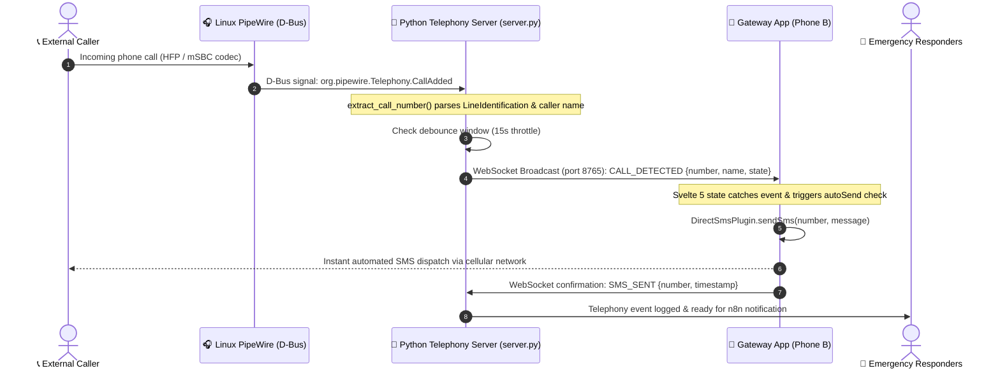
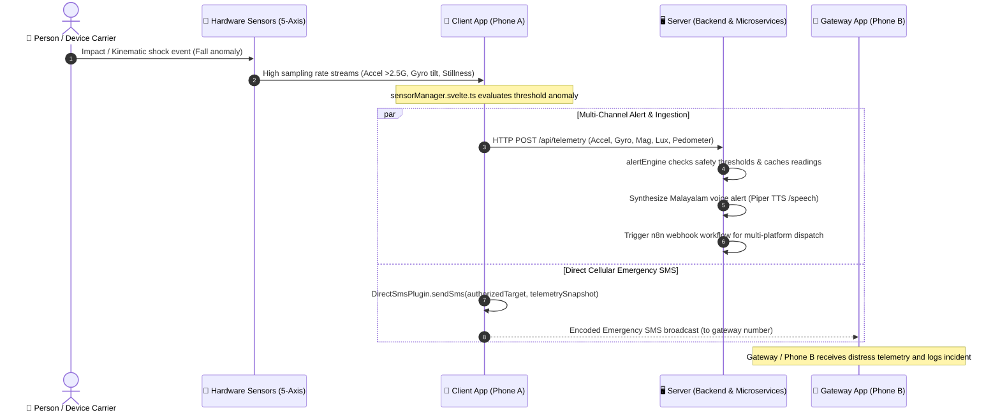
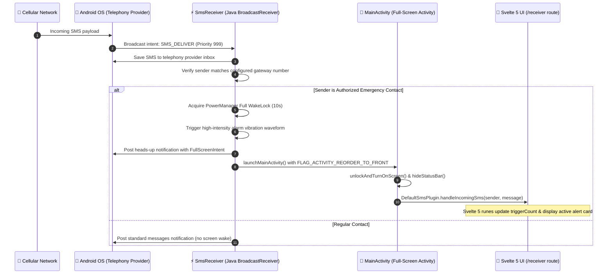

# kaaka — Kaaka Emergency Telemetry & Response Platform

> **Abstract**: An edge-aware emergency telemetry and rapid-response system combining real-time physical sensor detection with automated telephony gateways and localized speech microservices. Built with Capacitor 7, Svelte 5 (runes mode), Node.js, Linux PipeWire D-Bus telephony monitors, and Malayalam voice AI (TTS/ASR), the platform bridges on-device incident detection with automated dispatch and base-station notification channels for reliable emergency intervention.

Plan, status and next steps: [docs/PLAN.md](docs/PLAN.md) · Device test checklist: [docs/TESTING.md](docs/TESTING.md)

## Unified setup: Mac + S23

The whole system is two devices. Callers are outside people using their own phones.

| Device | Role | What runs |
|---|---|---|
| **Galaxy S23** (the gateway number) | Telephony | **Kaaka Call** gateway app: screens incoming calls, rejects them, sends the caller an auto-reply SMS, and receives "Kaaka Alert" SMS reports |
| **Mac** | Dashboard / server | `server/server.py` **without `--bt-mac`**: receives the S23's events over Wi-Fi and shows them on the dashboard |

Flow:

1. A caller rings the S23's number.
2. The gateway app on the S23 screens the call, rejects it and sends an auto-reply SMS (no SMS when the caller ID is hidden).
3. The S23 reports the call to the Mac: `POST http://<mac-ip>:8080/api/call-event` with `{"number", "state": "rejected"|"allowed", "sms": "sent"|"failed"|"skipped", "timestamp"}`. The dashboard feed shows e.g. "call from … — rejected, auto-reply sent".
4. If a caller uses the optional **Kaaka Sensors** app, it sends "Kaaka Alert" SMS reports to the S23; the gateway app logs them and forwards them to the Mac (`POST /api/telemetry`).
5. The S23 also sends a periodic heartbeat (`POST /api/heartbeat` with battery and setup state). The dashboard shows "s23: last seen …" and turns it into a warning when no heartbeat arrived for 20 minutes or call screening, SMS or contact-call permissions are missing.

Start the dashboard server on the Mac (no Bluetooth):

```bash
.venv-mac/bin/python server/server.py
```

Then, in the gateway app on the S23, set **Dashboard server** to `http://<mac-ip>:8080` (the server prints its IP on startup). Both devices must be on the same Wi-Fi.

**Do not combine this with the Bluetooth mode.** In this mode the server runs without `--bt-mac`. If the Mac were also connected to the S23 as a Bluetooth hands-free unit, both the Mac and the S23's own call screening would hang up the same call and handle it twice. The macOS Bluetooth section below describes an alternative mode, not an add-on.

**Kaaka Sensors (`client/`) is optional.** It is only for callers who choose to install it on their own phones; the S23 gateway does not need it.

### Incidents, location links and acknowledgements

- **Incidents:** the dashboard groups calls, alert reports, shared locations and acknowledgements by caller number (last 10 digits) and highlights incidents still awaiting acknowledgement. A new call or alert after an acknowledgement needs a fresh one. History is appended to `server/events.jsonl` (runtime data, not committed) and reloaded on start.
- **Location link for callers without the app:** see [Location links for callers without the app](#location-links-for-callers-without-the-app) below.
- **Acknowledgement:** when a responder replies "ACK" to the S23, the gateway app reports it (`POST /api/ack`) and the incident shows "acknowledged by …".
- **Help by SMS:** a help SMS handled by the gateway app is reported as `state: "sms"` with the message text; the incident lists it under "help sms" and shows the latest message.
- **Caller reports safe:** when the caller texts `SAFE` (also "I'm safe", "I am safe", or സുരക്ഷിതം) to the S23 while they have an open incident, the gateway app replies that the alert is closed, tells responders, and posts `/api/resolve` with `by: "caller"`. The dashboard shows a green "safe" badge, "closed by caller · reported safe", `closed_by_caller: true` in `/api/incidents`, and the Mac notification "Caller reported safe". Kaaka Sensors has an "I'm safe — close my alert" button that stops the beacon and sends this text.
- **Status:** each incident is `open` (needs attention, highlighted), `acknowledged` (a responder replied ACK) or `resolved` (greyed). Resolve it with the dashboard's **[resolve]** button (optional note) or a responder's `RESOLVE` SMS through the gateway (`POST /api/resolve`). A later call, help SMS or alert reopens it. **[hide resolved]** filters the list.
- **Mac notifications:** on macOS the server posts a notification for a new or reopened incident, an acknowledgement, a resolution, and when the gateway phone goes silent (no heartbeat for 20 minutes) or comes back. Disable with `--no-notify` or `KAAKA_NOTIFY=0`. The dashboard also receives `GATEWAY_STALE` over the WebSocket.
- **Map:** the dashboard's incident map shows each incident's latest location on OpenStreetMap (Leaflet 1.9.4 from cdnjs). It needs internet; offline, the panel says the map is unavailable and the rest of the dashboard works.
- **CSV export:** **[download csv]** or `GET /api/incidents.csv` (same admin-token rule as `/api/incidents`).
- **Nearest responders and dispatch:** register responders (name, number, home position) in the dashboard's **Responders** panel (type `lat, lon` or **[pick on map]**; toggle availability). Each incident with a location shows its nearest available responders with straight-line distance and an ETA that assumes 25 km/h city travel (a planning estimate). The first time an open incident gets a location, the server **dispatches** the 1–2 nearest available responders: it records them on the incident, broadcasts `RESPONDER_DISPATCHED`, and returns them in the `/api/telemetry` response so the gateway app texts each one ("Kaaka dispatch: you are the nearest responder (1.2 km, ~3 min) to <caller>. Location: <maps> Reply ACK <caller> to confirm."). Later reports of the same open incident do not dispatch again; a resolved incident that reopens does. The map draws a dashed line from the nearest responder to each open incident, labelled with distance and ETA. Responders live in `server/responders.json` (runtime data, not committed).

### Location links for callers without the app

Most callers will not have Kaaka Sensors. The reply SMS can carry a link that works in any phone browser:

1. The gateway app gives each call a random link token and reports it with the call (`POST /api/call-event`, `token`). When it knows a public URL, the reply ends with `Share your location: https://<public-url>/l/<token>`.
2. The caller opens the link, taps **Share my location**, and the browser's GPS position is posted to `POST /api/location`. While the page stays open it keeps sending an update every 15 s ("Sharing live location · N updates", with a **Stop sharing** button), so a moving caller leaves a trail on the dashboard map.
3. The location appears on the caller's incident with a Google Maps link. Links expire after 24 hours; the server accepts at most one update per link every 10 s.

**Setup.** Browsers only share location over **https**, so the dashboard must be reachable at a public https URL:

- `scripts/public-url.sh` opens a Cloudflare quick tunnel to the dashboard (needs `brew install cloudflared`), prints the `https://…trycloudflare.com` URL and the exact commands for the next steps. The URL changes on every run; for a permanent address use a named tunnel or a hosted server.
- Restart the server with `KAAKA_PUBLIC_URL=<url> KAAKA_ADMIN_TOKEN=<token>`. **The server refuses to start with a public URL and no admin token** (override with `--allow-unprotected-public` only for a throwaway test): a public URL puts callers' numbers and locations on the internet, and the token keeps the dashboard and gateway endpoints private. Only `/l/<token>` and `POST /api/location` stay public.
- In Kaaka Call, set the same **dashboard token**. The phone learns the public URL from the dashboard's heartbeat reply (`POST /api/heartbeat` returns `public_url`) within a minute and shows it as "auto: …" under the **public link url** field; set that field only to pin a different URL.

### Server settings

| Setting | Purpose |
|---|---|
| `KAAKA_ADMIN_TOKEN` (env) | Optional. When set, the dashboard, `/api/status`, `/api/incidents`, the WebSocket and all gateway `POST` endpoints require the token as header `X-Kaaka-Token`, query `?token=`, or the dashboard cookie (open the dashboard once as `/?token=…`). Use letters and digits. Location links stay public. |
| `--public-url` / `KAAKA_PUBLIC_URL` | Optional public https URL of this server. Returned to the gateway app in the heartbeat reply (it builds the location links from it), shown in the startup banner and `/api/status`. Requires `KAAKA_ADMIN_TOKEN` unless `--allow-unprotected-public` is given. |
| `--no-notify` / `KAAKA_NOTIFY=0` | Turn off macOS notifications. |
| `KAAKA_STALE_SECONDS` (env) | Seconds without a heartbeat before the gateway phone counts as silent (default 1200). |

With `KAAKA_ADMIN_TOKEN` set, the client app's live sensor stream and its WebSocket copy (which send no token) are refused; the SMS alert path through the S23 is unaffected. The dashboard's WebSocket uses port 8765 on the same host, so through a tunnel the dashboard falls back to status/incident polling.

### Gateway → server API

All bodies are JSON. Errors return `{"success": false, "error": "…"}`.

| Endpoint | Body | Responses |
|---|---|---|
| `POST /api/call-event` | `number` (string, `""` if hidden), `state` (`rejected`\|`allowed`, or `sms` for a help SMS), `sms` (`sent`\|`failed`\|`skipped`), `timestamp` (ISO-8601 string), optional `token` (6–32 of `A-Z a-z 0-9 _ -`, the location-link token sent to this caller), optional `message` (help SMS text, max 500 characters) | 200, 400, 401 |
| `POST /api/telemetry` | `report` (alert text, e.g. a forwarded "Kaaka Alert" SMS) and `sender`; or the client app's live stream `{deviceId, sensors: {...}}` | 200, 401 |
| `POST /api/heartbeat` | `timestamp`, `battery` (int −1…100), `charging`, `screeningRole`, `smsGranted`, `contactCalls` (booleans; all optional) | 200 `{"success": true, "public_url": "…"}`, 400, 401 |
| `POST /api/telemetry` | `report` (alert text, e.g. a forwarded "Kaaka Alert" SMS) and `sender`; or the client app's live stream `{deviceId, sensors: {...}}` | 200 `{"success": true, "dispatch": [{name, number, distance_km, eta_min, maps_url}]}` (`dispatch` is non-empty only the first time an open incident gets a location; empty for the live stream), 401 |
| `POST /api/heartbeat` | `timestamp`, `battery` (int −1…100), `charging`, `screeningRole`, `smsGranted`, `contactCalls` (booleans; all optional) | 200, 400, 401 |
| `POST /api/ack` | `number` (caller being acknowledged, required), `responder` (string), `timestamp` (ISO-8601 string) | 200, 400, 401 |
| `POST /api/resolve` | `number` (incident to close, required), `by` (string, default `"dashboard"`, max 100), `note` (max 500), `timestamp` (ISO-8601 string) | 200, 400, 401, 404 (no incident for this number) |
| `POST /api/location` (public) | `token`, `lat` (−90…90), `lon` (−180…180), optional `accuracy` (metres) | 200, 400 (malformed), 404 (unknown or expired token), 429 (more than one update per 10 s for this token) |
| `GET /l/<token>` (public) | — | 200 location page, 404 unknown or expired |
| `GET /api/incidents` | — | 200 `{"incidents": [...]}` (newest first, max 50; each with `status` `open`\|`acknowledged`\|`resolved`, `calls`, `help_sms`, `alerts`, `locations`, `acknowledged`, `resolved`, `latest_location`), 401 |
| `GET /api/responders` | — | 200 `{"responders": [{id, name, number, lat, lon, available}]}`; 401 |
| `POST /api/responders` | `name` (≤ 80 chars), `number` (phone number), `lat`, `lon`, optional `available` (default true) | 200 `{"success": true, "responder": {…}}`, 400, 401 |
| `PATCH /api/responders/<id>` | any of the fields above | 200, 400, 401, 404 |
| `DELETE /api/responders/<id>` | — | 200, 401, 404 |
| `GET /api/incidents.csv` | — | 200 CSV: `number,status,first_seen,last_seen,calls,help_sms,alerts,latest_lat,latest_lon,acknowledged_by,acknowledged_at,resolved_by,resolved_at,resolved_note`; 401 |
| `GET /api/status` | — | 200 status incl. `last_heartbeat`, `gateway_stale`, `public_url`, `admin_token_enabled`; 401 |

---

## Project Description

**kaaka** establishes an integrated emergency response loop split across three specialized components:

* **Client App (`client/`)** — Personal device application monitoring 5 hardware sensors (accelerometer, gyroscope, magnetometer, ambient light, pedometer). It evaluates kinematic thresholds to detect incidents/falls, packages live telemetry into emergency SMS broadcasts, and acts as a designated Android Default SMS Handler to execute full-screen wake locks, lockscreen dismissal, and continuous vibration alarms upon authorized triggers.
* **Gateway App (`gateway/`)** — Mobile base-station client that links with local telephony listeners via WebSockets. It detects incoming calls over Bluetooth hands-free profiles (HFP) in real time and automatically dispatches immediate SMS alerts to callers without requiring manual device interaction.
* **Server & Services (`server/`)** — Edge infrastructure hosting real-time telemetry ingestion and WebSocket distribution (`server/backend`), PipeWire/oFono telephony D-Bus monitors (`server/server.py`), live bidirectional call audio bridge (`server/audio_bridge.py`), localized Malayalam Piper TTS (`server/services/malayalam-tts`), Malayalam voice ASR (`server/services/malayalam-voice-asr`), n8n workflow automation (`server/services/n8n`), and incident dashboard (`server/dashboard.html`).
* **Bidirectional Voice AI Loop** — Captures active Bluetooth phone call audio, transcribes Malayalam speech using the fine-tuned **Thennal Whisper** model, generates context-aware responses with **Gemma** via **Ollama**, synthesizes fluent speech using the **Meera ONNX** voice on **Piper TTS**, and injects audio back into the call uplink so callers converse with a local AI assistant in real time.

---

## Architecture

```
kaaka/
├── client/                     # Sensor telemetry, fall detection & default SMS receiver
├── gateway/                    # Automated Bluetooth call monitor & quick-dial app
└── server/
    ├── backend/                # Telemetry ingestion & WebSocket streaming server
    ├── services/
    │   ├── malayalam-tts/      # Malayalam Piper Text-to-Speech container (Meera model)
    │   ├── malayalam-voice-asr/# Malayalam Speech Recognition service (Thennal Whisper model)
    │   └── n8n/                # n8n event orchestration workflows
    ├── audio_bridge.py         # Real-time Bluetooth call audio recording & AI playback bridge
    ├── server.py               # PipeWire Bluetooth call monitor & WebSocket server
    ├── dashboard.html          # Real-time incident & telemetry web dashboard
    └── extract_call_number.py  # D-Bus telephony inspection CLI
```

---

## System Sequence Diagrams

The interactions between **Client (App)**, **Gateway (App)**, and **Server** are coordinated via cellular SMS, local WebSockets, D-Bus IPC, PipeWire audio routing, and HTTP REST APIs.

### 1. Hands-Free Telephony & Auto-Responder (`server.py` & Gateway)
When an incoming call is picked up via Bluetooth hands-free audio, the Python telephony server extracts caller metadata over Linux D-Bus and coordinates with the Gateway app over WebSockets for automatic SMS response.



---

### 2. Emergency Incident Detection & Server Telemetry Ingestion
When kinematics detect an emergency or fall anomaly, the Client app executes multi-channel alerting: syncing full 5-axis telemetry with the backend server while dispatching an emergency SMS payload to the Gateway.



---

### 3. Default SMS App Role & Emergency Alarm Wake Lock
When an incoming emergency trigger is received on an Android device running the Client app with the Default SMS role, it intercepts the message at highest priority, bypasses lockscreens, and sounds vibration alarms.



---

### 4. Bidirectional Malayalam Voice AI Conversation Loop (`audio_bridge.py` & n8n)
During an active Bluetooth call, the audio bridge records 10s segments and routes them through a complete edge AI pipeline—transcribing via Thennal Whisper, reasoning via Gemma on Ollama, synthesizing fluent Malayalam speech via Piper TTS (Meera model), and streaming the reply directly into the phone call uplink.

```mermaid
sequenceDiagram
    autonumber
    actor Caller as 📞 Caller
    participant PW as 🎧 PipeWire / PulseAudio (HFP Audio)
    participant Bridge as 🎙️ audio_bridge.py
    participant N8N as ⚡ n8n Webhook Workflow
    participant Thennal as 🗣️ Thennal Whisper ASR
    participant Ollama as 🧠 Ollama (Gemma LLM)
    participant Meera as 🔊 Piper TTS (Meera Model)

    Caller->>PW: Speaks in Malayalam over active Bluetooth phone call
    PW->>Bridge: Routes call audio to call_record null-sink
    Note over Bridge: Records 10s audio segment & encodes to MP3 via ffmpeg
    Bridge->>N8N: POST /webhook/passive (record.mp3)

    rect rgb(20, 30, 40)
        Note over N8N: Voice AI Conversation Pipeline
        N8N->>Thennal: Pass audio chunk for speech transcription
        Thennal-->>N8N: Extracted Malayalam text (Thennal fine-tuned Whisper)
        N8N->>Ollama: Prompt with transcript, emergency telemetry & intent
        Ollama-->>N8N: Generated Malayalam conversational response (Gemma)
        N8N->>Meera: Synthesize response text into speech (ml_IN-meera-medium.onnx)
        Meera-->>N8N: High-quality neural Malayalam audio reply
    end

    N8N-->>Bridge: Returns generated Malayalam audio response (.mp3/.wav)
    Bridge->>PW: Injects audio into call_playback sink & BlueZ mic uplink
    PW-->>Caller: Plays synthesized AI voice directly into phone earpiece
    Note over Caller,Bridge: Conversation continues iteratively for duration of active call
```



## Quick Start

### Client (App)
```bash
# Run web preview
npm run dev:client

# Build web assets
npm run build:client
```

### Gateway (App)
```bash
# Run web preview
npm run dev:gateway

# Build web assets
npm run build:gateway
```

### Server
```bash
# Run telemetry server
npm run dev:server

# Run Bluetooth telephony listener
python3 server/server.py
```

---

## Optional alternative: Mac as a Bluetooth hands-free unit (macOS)

> Alternative to the unified Mac + S23 setup above, not to be combined with it: here the Mac detects and hangs up calls over Bluetooth (`--bt-mac`) and the gateway app only sends the SMS.

The server side also runs on an Apple Silicon Mac (tested on macOS 27). The Linux PipeWire/oFono telephony layer is replaced by `mac/hfp-bridge`, a small Swift helper that connects to the phone as a Bluetooth hands-free unit through Apple's IOBluetooth framework. `server/server.py` starts it automatically and talks to it over stdin/stdout. All Linux code paths are unchanged.

### Setup

Run all commands from the repository root (`kaaka/`).

1. **Pair the phone** with the Mac (System Settings → Bluetooth), and allow **Calls** for the Mac in the phone's Bluetooth settings for that device.
2. **Build the bridge:**
   ```bash
   (cd mac/hfp-bridge && swift build -c release)
   ```
3. **Bluetooth permission:** macOS asks the app you launch the server from (Terminal, iTerm, VS Code…). Allow it under System Settings → Privacy & Security → Bluetooth. Without it, the bridge hangs or sees no devices.
4. **Python environment:**
   ```bash
   python3 -m venv .venv-mac
   .venv-mac/bin/pip install -r server/requirements-mac.txt
   ```
5. **Run** with your phone's Bluetooth address (shown in System Settings → Bluetooth or `system_profiler SPBluetoothDataType`); the address below is only an example:
   ```bash
   .venv-mac/bin/python server/server.py --bt-mac AA:BB:CC:DD:EE:FF   # your phone's Bluetooth address (System Settings → Bluetooth)
   ```
   Leave the terminal input alone while it runs: pressing Enter in the server console simulates a call.
   Set `HFP_BRIDGE_BIN` to use a bridge binary from another location.

   Settings (nothing is hardcoded; unset optional settings disable that feature):

   | Option | Environment variable | Purpose |
   |---|---|---|
   | `--bt-mac` (this mode only) | `KAAKA_BT_MAC` | Gateway phone's Bluetooth address; omit it for the unified Mac + S23 setup |
   | `--client-number` | `KAAKA_CLIENT_NUMBER` | Client (sensor) phone number; its SMS are read as telemetry (otherwise only "Kaaka Alert" texts match) |
   | `--adb-serial` | `KAAKA_ADB_SERIAL` | adb device to read SMS from (default: the only attached device) |
   | — | `KAAKA_WEBHOOK_URL`, `KAAKA_WEBHOOK_FALLBACK_URL` | n8n voice-AI webhook (Linux audio bridge; off when unset) |
   | — | `KAAKA_SPEAKER_SINK`, `KAAKA_MIC_SOURCE` | Linux PipeWire speaker/mic (default: system defaults) |
   | — | `KAAKA_TTS_PYTHON` | Python with `piper-tts` for `npm run tts` |

   Calls without caller ID stay "unknown" and never trigger an auto-reply SMS. The last real caller is kept in `server/last_call.json` (not committed).
6. **Point the Gateway app** at the Mac: open its settings and set the WebSocket URL to `ws://<Mac's Wi-Fi IP>:8765` (the server prints this IP on startup).

### What works on macOS

| Feature | macOS | Notes |
|---|---|---|
| Incoming call detection + caller number → `CALL_DETECTED` over WebSocket | ✅ | via `hfp-bridge` |
| Gateway app auto-SMS reply | ✅ | triggered by `CALL_DETECTED` |
| Answer / 1-ring hangup | ✅ | via `hfp-bridge`. **Default mode on macOS is 1-ring hangup**; toggle with `POST /api/audio-bridge/mode` |
| Hands-free auto-reconnect | ✅ | `hfp-bridge` reconnects itself (replaces the BlueZ watchdog) |
| Dashboard (`:8080`), WebSocket (`:8765`), HTTP/WebSocket telemetry, ADB SMS ingest | ✅ | unchanged |
| Bluetooth MAP SMS reading / sending | ❌ | macOS has no Message Access Profile client API. Telemetry still arrives via ADB, HTTP and WebSocket; the reply SMS is sent by the Gateway app |
| Voice AI loop (`audio_bridge.py`: call audio → n8n → reply into the call) | ❌ | macOS refuses hands-free call audio: IOBluetooth's `connectSCO` returns `kIOReturnUnsupported`, and no Bluetooth audio device appears in CoreAudio. Call audio stays on the phone. The dashboard reports the bridge as "unsupported on macOS" |

For the voice AI loop, keep using the Linux setup (or a Linux machine/VM with its own USB Bluetooth adapter).

---

Project records: [CHANGELOG.md](CHANGELOG.md) · [AI_USAGE.md](AI_USAGE.md) · [docs/PLAN.md](docs/PLAN.md)
